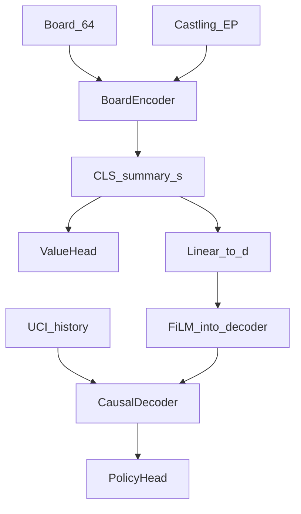
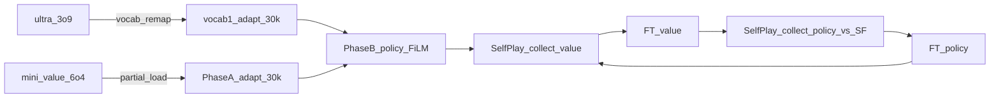

# Unified Board + History Policy-Value Network

Standalone next-generation architecture for MCTS hard mode. Lives under `unified_mcts/` — does **not** modify `policy_transformer/` or `value_transformer/`.

> Cursor Markdown Preview does not render LaTeX. Equations use plain code blocks.

---

## 1. Motivation

MCTS wants **one** model that, for position `s`, returns priors **π(a | s)** and scalar **v(s)**.

This package:

1. **Board encoder** (self-attention + rank/file + castling/EP) → CLS summary `s`
2. **UCI history decoder** (RoPE, causal) **FiLM-conditioned** by `s` (`d_c = d`)
3. **Policy head** + **value head** on the same checkpoint (`JointChessNet`)

Keep **one joint net**; Phase B / fine-tunes only change which parameters have `requires_grad`.



---

## 2. Curriculum (locked)



**Why warm-start both towers:** Phase B's single-target CE gives ~250× fewer supervised
predictions per step than the dense legacy LM objective. Training the decoder from random
init under that thin objective stalls (~CE 5 after 30k). Production towers already encode
chess; we only adapt interfaces (vocab1 action set; CLS + castling/EP tokens), then teach
FiLM to fuse them.

### Warm-start provenance

| Tensor group | Source | Notes |
|---|---|---|
| Decoder body + vocab1 emb/`lm_head` | `ultra_3o9.pt` remapped via `vocab.pkl`→`vocab1.pkl` | 100% token overlap; FiLM zero-init at Phase B |
| Encoder piece/rank/file + blocks + value MLP | `mini_value_6o4.pt` | Same 384/6/6 shapes |
| CLS, castle_emb, ep_emb | fresh | Unified-only; adapted in Phase A |
| FiLM / `cond_proj` | fresh (FiLM zero) | Learned in Phase B |

Production checkpoints are **read-only inputs**. Helpers live in [`warmstart.py`](warmstart.py).

### Phase A — value adapt (production → unified encoder)

- Data: Lichess eval memmaps (`value_*`)
- Init: `load_legacy_value_encoder` from `mini_value_6o4.pt`
- Train: `BoardEncoder` + `ValueHead` (dual LR: fresh CLS/rights vs pretrained body)
- Freeze: entire policy decoder / FiLM / UCI emb / lm_head
- Loss: `L_A = MSE(v, tanh(cp/400))`
- Default budget: **30k** iters

### Phase B — policy only (no SF labels required)

- Load Phase A into encoder + value head
- Warm-start decoder from adapted vocab1 policy (`best_ultra_v1_o1.pt`); **zero FiLM**
- **Freeze** `BoardEncoder` + `ValueHead` (stable FiLM condition)
- Train: decoder + FiLM + token emb + lm_head (+ `cond_proj`)
- Loss: single-target policy CE on the move matching the FiLM board (last hist token)
- Data: `1-0` as-is, `0-1` game-mirrored so winner=White; every row STM-white into the net

### Self-play iterate (vs Stockfish)

1. **`kaggle_selfplay_collect.ipynb` / `self_play_sf.py`** — N parallel shards. Unified vs SF. Value: mine `|v_θ − y_SF| ≥ 0.15` on unified top-k children. Policy: every SF ply (STM-white) + optional SF-best at error boards.
2. **`merge_ft_shards.py` (local)** — concatenate shards → one `value_ft/` + one `policy_ft/`.
3. **`kaggle_ft_value.ipynb` (FT-A)** — unfreeze encoder + value; freeze decoder; `MixedValueFTDataset` 70/30 self-play / Lichess.
4. **`kaggle_ft_policy.ipynb` (FT-B)** — freeze encoder + value; train decoder/FiLM; `MixedPolicyPtReplayFTDataset` 70/30 self-play / pt_replay.

Repeat ~10 cycles. Next collectors attach `unified_sp_cycleN.pt`.

---

## 3. Architecture math (brief)

Board embed:

```text
e_i = E_piece(x_brd[i]) + E_rank(ρ(i)) + E_file(φ(i))
Z⁰ = [c₀ ; e₀…e₆₃ ; e_castle ; e_ep]
s = Z^{L_b}_CLS ∈ R^{d_b}
```

FiLM (`d_c = d`):

```text
C = W_c · s + b_c ∈ R^d
FiLM_ℓ(h|C) = (1 + γ_ℓ(C)) ⊙ LN(h) + β_ℓ(C)
```

Policy / value:

```text
π = softmax(W_π · u^L_t + b_π)
v = tanh(MLP_v(s))
```

Defaults: `d_b=384`, `L_b=6`, `d=500`, `L=8`, `V=1793`, `T_max=128`.

---

## 4. Freeze schedule

| Stage | Encoder | ValueHead | cond_proj | Decoder+FiLM |
|-------|---------|-----------|-----------|--------------|
| Phase A | train | train | frozen (no policy loss) | frozen |
| Phase B | frozen | frozen | train | train |
| FT value | train | train | frozen | frozen |
| FT policy | frozen | frozen | train | train |

After FT value, always run FT policy next so FiLM/`cond_proj` re-adapt to the updated encoder CLS.

**Rights note:** Phase A Lichess mega has no castling/EP → rights memmap is zeros. Castle/EP embeddings stay near-init until value FT (self-play writes real rights). Policy Phase B still passes real rights into the frozen encoder; that is OK (fixed lookup features) but value is slightly off until FT.

---

## 5. Memmaps

**Phase A / value FT:** `value_X`, `value_R`, `value_Y`, `value_meta.json`

**Phase B / policy FT:** `policy_hist`, `policy_board`, `policy_R`, `policy_y`, optional `policy_yv` (zeros if no SF), `policy_meta.json`

---

## 6. Get training soon

1. `preprocess_value.py` → Kaggle Phase A **now**
2. `preprocess_policy.py` **without Stockfish** (cap games) → Phase B when Phase A ckpt ready
3. Self-play collect (parallel shards) → local fuse → FT-A value → FT-B policy

---

## 7. Non-goals

- Fully separate unrelated model classes
- Offline SF on all policy plies for Phase B
- Online SF inside Phase B train loop
- WDL / tabula rasa / RunPod hard-mode rewire

## 8. File map

| File | Role |
|------|------|
| `model.py` | `JointChessNet` + freeze helpers |
| `train_phase_a.py` / `train_phase_b.py` | Pretrain stages |
| `finetune_value.py` / `finetune_policy.py` | FT stages |
| `self_play_sf.py` / `merge_ft_shards.py` | Parallel SF collect + local shard fuse |
| `self_play_value.py` / `self_play_policy.py` | Older separate collectors |
| `preprocess_*.py`, `dataset.py`, `inference.py`, `mcts_adapter.py` | Support |
| `kaggle_selfplay_collect.ipynb` | Kaggle shard collector |
| `kaggle_ft_value.ipynb` / `kaggle_ft_policy.ipynb` | FT-A / FT-B |
| `kaggle_train_phase_*.ipynb` | Initial Phase A / B runners |
