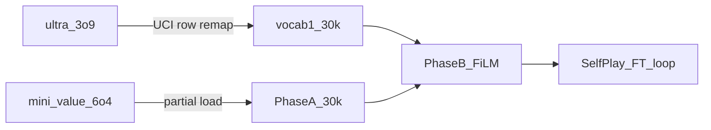
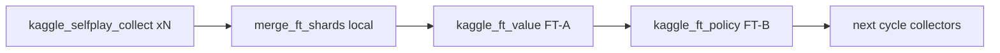

# Unified MCTS Policy-Value

Joint board-encoder + FiLM UCI decoder (`JointChessNet`). See [ARCHITECTURE.md](ARCHITECTURE.md).

**Pipeline principle:** never train towers from scratch. Warm-start from production
weights (read-only copies), adapt to the unified / vocab1 interfaces, then fuse with FiLM.

Production files used as **inputs only** (never modified in-place):

| Production file | Role |
|---|---|
| `policy_transformer/ultra_3o9.pt` + `vocab.pkl` | Remap → vocab1 policy warm-start |
| `value_transformer/mini_value_6o4.pt` | Phase A encoder + value warm-start |



---

## 0) Vocab1 policy adapt (production → 1793)

Notebook: [`../policy_transformer/kaggle_train_policy_vocab1.ipynb`](../policy_transformer/kaggle_train_policy_vocab1.ipynb)

Warm-starts from `ultra_3o9.pt` by copying the transformer body and gathering emb/`lm_head`
rows for every vocab1 token (100% overlap with `vocab.pkl`). Fine-tunes **30k** steps at
LR **1e-4**. Step-0 CE must be **&lt; 4** (expect ~1.9–2.5).

**Kaggle upload:**

| File | From |
|---|---|
| `full_X/Y.pt`, `elite_X/Y.pt`, `weak_X/Y.pt` | `data/` |
| `vocab1.pkl`, `vocab.pkl`, `ultra_3o9.pt` | `policy_transformer/` |

Download **`best_ultra_v1_o1.pt`** (prefer) from `/kaggle/working/`.

---

## 1) Phase A value adapt (production → CLS/rights)

Value memmaps (once):

```bash
cd unified_mcts
python build_value_from_lichess.py \
  --out ./data_export/value \
  --max-n 50000000 \
  --min-depth 20
```

**Kaggle:** `kaggle_train_phase_a.ipynb` — attach:

- `data_export/value/` (`value_X/R/Y` + `value_meta.json`)
- `mini_value_6o4.pt` (read-only)

Warm-starts piece/rank/file + blocks + value head from production; CLS/castle/EP stay fresh.
**30k** iters, dual LR (fresh 3e-4 / pretrained 1e-4). Download **`unified_phase_a_best.pt`**.

Local equivalent:

```bash
python train_phase_a.py \
  --data ./data_export/value \
  --legacy-value ../value_transformer/mini_value_6o4.pt \
  --max-iters 30000 \
  --out unified_phase_a.pt
```

---

## 2) Phase B — FiLM fusion

Build policy replay indices (once; boards on the fly):

```bash
python build_policy_from_pt.py \
  --data-dir ../data \
  --vocab ../policy_transformer/vocab1.pkl \
  --out ./data_export/policy_pt \
  --no-copy-streams
```

**Kaggle:** `kaggle_train_phase_b.ipynb` — attach:

- `unified_phase_a_best.pt`
- `best_ultra_v1_o1.pt` (from step 0)
- policy streams + `policy_pt/` indices + `vocab1.pkl`

Loads Phase A into encoder/value (frozen), warm-starts decoder from vocab1 ckpt with
**FiLM zeroed**, trains FiLM/`cond_proj` (+ light decoder FT). Output: `unified_phase_b.pt`.

Local:

```bash
python train_phase_b.py \
  --data ./data_export/policy_pt \
  --phase-a ./ckpts/unified_phase_a_best.pt \
  --legacy-policy ./ckpts/best_ultra_v1_o1.pt \
  --out unified_phase_b.pt
```

**Convention:** streams use winner-as-White UCI tokens; `Y<0` skips loser plies. Replay
un-mirrors Black-win streams, then STM-white-encodes the board.

---

## 3) Self-play iterate (unified vs Stockfish)

Three Kaggle notebooks + a **local fuse** step. Collectors run in parallel; FT-A then FT-B.



**Collect** (`kaggle_selfplay_collect.ipynb`) — CPU, one shard per session (`SHARD_ID`). Unified vs SF: MultiPV temperature on SF, `P_OPTIMAL=0.7` value-rerank on unified. Writes `sp_shard_{id}/value_ft/` + `policy_ft/`.

**Fuse locally:**

```bash
# Drop Kaggle results.zip files into unified_mcts/shards/ then:
python merge_ft_shards.py
# → data_export/sp_cycle1/{value_ft,policy_ft}/  (zips deleted)
```

Upload `sp_cycle1/value_ft` and `sp_cycle1/policy_ft` as Kaggle datasets.

**FT-A** (`kaggle_ft_value.ipynb`) — GPU. `ft_value` freeze, mixed batches `ft_frac=0.7` self-play + 0.3 Lichess value. Output: `unified_sp_value_cN.pt`.

**FT-B** (`kaggle_ft_policy.ipynb`) — GPU. Loads FT-A ckpt, `ft_policy` freeze, mixed batches with pt_replay base. Output: `unified_sp_cycleN.pt` (next collector ckpt).

Local collector (one shard):

```bash
python self_play_sf.py \
  --ckpt ./ckpts/unified_phase_b_best.pt \
  --vocab ../policy_transformer/vocab1.pkl \
  --stockfish /path/to/stockfish \
  --out ./data_export/sp_shard_0 \
  --shard-id 0 --games 200 --cores 4
```

---

## Head-to-head

`head_to_head.py` — production vs unified. Defaults: **100** policy games, **100** value games, **10** MCTS games at **100** sims. Add `--vis` to write `simulate_viz/board.svg`.

```bash
cd unified_mcts
python head_to_head.py --mode policy
python head_to_head.py --mode value
python head_to_head.py --mode mcts --games 10 --sims 100
python head_to_head.py --mode mcts --games 1 --sims 100 --vis
```

- **policy** — same as `policy_transformer/simulate_game.py` (softmax sample over own top-7)
- **value** — same as `value_transformer/simulate_game.py` `get_move` (own top-7, 1-ply own value, small policy mix)
- **mcts** — `engine/mcts.py` with each side’s policy+value (`QuietMCTS`, no per-move dump)

## Compare vs production (live board)

`compare_vs_production.py` plays **production** (`ultra_3o9.pt` + `mini_value_6o4.pt`) vs **unified** (`ckpts/unified_phase_b_best.pt`). Board SVG (auto-refresh in preview): `unified_mcts/simulate_viz/board.svg`.

```bash
cd unified_mcts
# 1) Policy only — sample each side's top-k
python compare_vs_production.py --mode policy --games 2 --delay 0.4

# 2) Value only — each side argmaxes its own value over legal moves
python compare_vs_production.py --mode value --games 2 --delay 0.3

# 3) Mix — Bernoulli: P(p-value) pick best value among policy top-k, else sample policy
python compare_vs_production.py --mode mix --p-value 0.5 --games 4
```

`--unified` defaults to `./ckpts/unified_phase_b_best.pt`. Open the SVG in a viewer that reloads on write.
